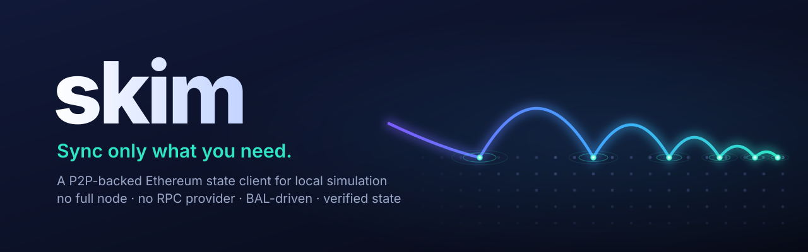
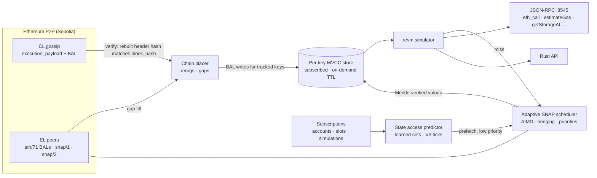

<p align="center">
  
</p>

<p align="center">
  <a href="#quick-start"></a>
  <a href="#"></a>
  <a href="rust-toolchain.toml"></a>
  <a href="#license"></a>
</p>

<p align="center"><b>Not every app needs a full node.</b></p>

**skim** is an application-specific Ethereum state client. You declare the state your app cares about: accounts, storage slots, or whole simulations. skim keeps exactly that state current, straight from the Ethereum P2P network, and runs your `eth_call`s locally against it in milliseconds. Anything else is fetched on demand, with Merkle proofs verified, only when a request needs it.

There is no full node, no RPC provider, and no block re-execution. The state follows the chain through Glamsterdam's [block-level access lists](https://eips.ethereum.org/EIPS/eip-7928) (BALs).

```console
$ skim run --config skim.yaml          # follows Sepolia, serves JSON-RPC on :8545
$ cast call 0xfFf9…6B14 "balanceOf(address)(uint256)" 0x3289…EfF1 --rpc-url http://127.0.0.1:8545
101838818991837710804 [1.018e20]       # unmodified Foundry, viem, ethers
```

---

## Why this is possible now

Until Glamsterdam, knowing the latest state meant executing every block, or asking a node that did. [EIP-7928](https://eips.ethereum.org/EIPS/eip-7928) changes that. Every block now commits to a **block access list**: every account and slot it touched, with the **post-values** it wrote. With ePBS, that list travels in the execution payload gossiped on the consensus layer.

skim builds on that:

| | How skim gets it |
|---|---|
| **New blocks + their state diffs** | CL `execution_payload` gossip. The EL header is rebuilt from the payload, so the BAL is bound to the block hash. eth/71 BAL requests fill gaps. |
| **State it has never seen** | snap/1 + snap/2 point lookups at the parent root, **verified against the state root with Merkle proofs**, then brought to the head by replaying the BAL |
| **Execution** | revm with Amsterdam rules over a per-key MVCC store |

## The model: subscribed state, on-demand everything else

| | **Subscribed** (your state watchlist) | **On demand** |
|---|---|---|
| What | Accounts, slots and simulations you declare | Everything else |
| Freshness | Applied from every block's BAL | Fetched for the requested block; cached for a TTL |
| Hot path | No network. Target: a few ms | One verified fetch wave, then local |
| Guarantee | **Ready** = head BAL applied **and** every required key known. Otherwise reported as not ready. | Best effort, and never wrong: unknown state is never treated as zero |

```yaml
# skim.yaml (see skim.example.yaml)
state:
  subscriptions:
    - name: weth-usdc-0.3%
      address: "0x6Ce0896eAE6D4BD668fDe41BB784548fb8F59b50"
      account: true
      storage: ["0x0", "0x4"]            # slot0, liquidity
    - name: my-quoter                     # a simulation you run every block
      calls:
        - to: "0xEd1f6473345F45b75F8179591dd5bA1888cf2FB3"
          data: "0xc6a5026a…"
      on_block: true                      # re-run each block; read via skim_subscriptionStatus
  on_demand: { enabled: true, cache_ttl_blocks: 4 }
  limits:    { max_subscribed_keys: 100000 }
```

Simulation subscriptions don't need you to know storage layouts. skim learns each call's access set, and protocol-aware predictors cover it too: for Uniswap V3, the tick range a swap of a given size can reach. Those keys stay warm.

## What we measured

All numbers are from Sepolia, measured from one home connection over public peers. Details and caveats are in [`docs/`](docs).

| | Result |
|---|---|
| **Correctness** | Every completed run matched Infura byte for byte at the same block hash. Totals: 1,753 calls in a 1-hour soak; 2,700 calls with randomized, never-seen Uniswap V3 quotes; 866 with proof verification on; 36/36 JSON-RPC requests ([P0](docs/m2-p0-miss-tail.md), [verified state](docs/m2-verified-state.md)). |
| **State ready after a new block** | BAL applied **0.16 ms** after the payload arrives. State ready at about **880 ms** P50 after slot start, bounded by gossip arrival ([M1](docs/m1-follower.md)). |
| **Warm simulation** | 7 calls (incl. Uniswap V3 quotes) in **3.8 ms** total; JSON-RPC `eth_call` in 0.5–6 ms |
| **Fetch reliability** | 298,084 SNAP jobs over public peers, **0 failed**, 126 disconnects absorbed ([soak](docs/m0-soak.md)) |
| **Unseen inputs** | Background prefetch had **99.9%** of predicted keys ready at call time. Worst on-path fetch: 1.6 s ([P1](docs/m2-p0-miss-tail.md)). |
| **Footprint** | ~120 MB RSS, ~0.25 CPU core, **0 bytes of disk** (a synced Sepolia full node used 337 GB) |
| **vs. a hosted RPC** | First answer for a new block: **tie** with Infura (P50 difference 0 ms). Every call after that is local. |

What skim is **not**: faster than an in-process full node on raw execution, or a trustless light client (yet). It saves *resources* while keeping simulation quality close to a node's. Part of the saving is work that public SNAP peers do on skim's behalf.

## Architecture



| Crate | Role |
|---|---|
| `skim-bal` | EIP-7928 decoding, commitment checks, per-key normalization |
| `skim-cl` | Minimal Gloas gossip listener: discv5, libp2p, envelope parsing, payload verification |
| `skim-el` | EL networking on reth: eth/71 BALs, snap/2 and a snap/1 client, head following |
| `skim-snap` | Adaptive request scheduler and SNAP Merkle-proof verification |
| `skim-state` | Per-key MVCC store: BAL application, base inserts with replay, reorg rollback, retention |
| `skim-sim` | revm over snapshots, state access predictor, subscriptions |
| `skim-cli` | `skim run` (JSON-RPC), `skim follow`, probes and benchmarks |

## Quick start

```bash
git clone https://github.com/leekt/skim && cd skim
cargo build --release                     # Rust 1.97 (pinned in rust-toolchain.toml)
./target/release/skim run --config skim.example.yaml
```

Wait for `state ready` in the log. Then point any Ethereum tooling at `http://127.0.0.1:8545`:

```bash
cast block-number --rpc-url http://127.0.0.1:8545
curl -s localhost:8545 -H 'content-type: application/json' \
  -d '{"jsonrpc":"2.0","id":1,"method":"skim_subscriptionStatus","params":[]}'
```

**Supported methods:**
- `eth_call` and `eth_estimateGas`
- `eth_getBalance`, `eth_getCode`, `eth_getStorageAt`, `eth_getTransactionCount`
- `eth_getBlockByNumber` / `eth_getBlockByHash`
- `eth_blockNumber`, `eth_chainId`, `net_version`, `eth_syncing`, `eth_gasPrice`, `web3_clientVersion`
- `skim_subscriptionStatus`

**Errors:**
- Out-of-scope methods (`eth_sendRawTransaction`, `eth_getLogs`, receipts) return `-32004`.
- State or blocks skim can't serve return `-32002`. skim never returns a fabricated value.

## Correctness rules skim lives by

- **Unknown is never zero.** A value is used only if it was written by a BAL, or fetched and verified.
- **A SNAP answer must prove itself.** Accounts are checked against the state root, slots against the verified storage root. A slot is zero only when *proven*: absent account, empty trie, or an exclusion proof. Anything else is "unavailable" and gets retried elsewhere.
- **Fetch at the parent, replay to the head.** At gossip time peers usually haven't executed the new block yet. skim reads at root(H−1) and applies BAL(H) itself.
- **Reorgs roll back only to the common ancestor**, using the EL chain, and replay from there.

## Trust model

| Checked | Not (yet) checked |
|---|---|
| BAL ↔ block hash (header rebuilt from the payload), block hash ↔ builder bid | Proof-of-stake fork choice and finality, BLS signatures |
| Every SNAP value ↔ the block's state root (Merkle proofs) | Execution correctness of the block itself |
| Header parent links, code hashes | |

Consensus light-client verification is on the roadmap. Until then, skim trusts the gossiped head the way an optimistic client does.

## Status and roadmap

- [x] M0: P2P feasibility (CL payload gossip, eth/71, snap/1+2, adaptive scheduler)
- [x] M1: BAL state follower with MVCC store
- [x] M2: simulator, JSON-RPC adapter, verified state, state access predictor
- [x] M3: subscriptions (subscribed vs on-demand state)
- [ ] Resource benchmark vs a Nethermind full node (same workload, same block hashes)
- [ ] **M4: selective state archiving.** `retention: archive` keeps every BAL-written version of subscribed state on disk, so `eth_getStorageAt` / `eth_call` work at historical blocks for what you subscribed to, from the block each key became known. *Sync and archive only what you need.*
- [ ] Generalized learned patterns (pool + direction + amount bucket + tick range), key and byte bounds
- [ ] `storage: all` for small contracts; WebSocket pushes for `on_block` subscriptions
- [ ] Consensus light-client verification; mainnet once Glamsterdam ships there

Design: [PROJECT.md](PROJECT.md). Experiment logs: [docs/](docs).

## License

Licensed under either of [Apache License 2.0](LICENSE-APACHE) or [MIT](LICENSE-MIT), at your option.
